# 射鵰篇 portrait contact sheet

First batch for visual approval. Select a thumbnail to open the 1024 × 1024 transparent PNG master. The thumbnails are 128 × 128 WebP exports.

| | | | |
| --- | --- | --- | --- |
| [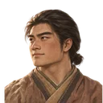](../assets/portraits/condor/guo_jing.png) **郭靖** | [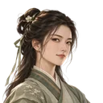](../assets/portraits/condor/huang_rong.png) **黃蓉** | [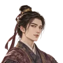](../assets/portraits/condor/yang_kang.png) **楊康** | [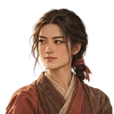](../assets/portraits/condor/mu_nianci.png) **穆念慈** |
| [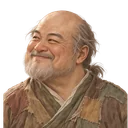](../assets/portraits/condor/hong_qigong.png) **洪七公** | [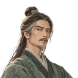](../assets/portraits/condor/huang_yaoshi.png) **黃藥師** | [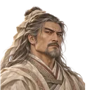](../assets/portraits/condor/ouyang_feng.png) **歐陽鋒** | [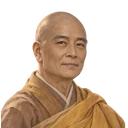](../assets/portraits/condor/yideng.png) **一燈大師** |
| [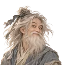](../assets/portraits/condor/zhou_botong.png) **周伯通** | [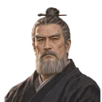](../assets/portraits/condor/qiu_chuji.png) **丘處機** | [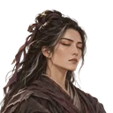](../assets/portraits/condor/mei_chaofeng.png) **梅超風** | [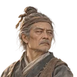](../assets/portraits/condor/ke_zhen_e.png) **柯鎮惡** |

## Character review

Each portrait was checked for natural proportions, clear faces and eyes, distinct facial structure and hair, period clothing, and safe bust crops. Silhouettes were inspected against parchment and dark jade, and face readability was checked down to 96 px.

The checkboxes record reviewer approval. All portraits are pending.

- [ ] **郭靖** — Broad jaw, straight brows, warm freckled complexion and a low tied knot. Earth-toned riding layers.
- [ ] **黃蓉** — Lively eyes and a slight knowing smile. Looped half-up hair, celadon blossom pin, and sage silk-linen.
- [ ] **楊康** — Narrow oval face, guarded gaze, high court knot and a gilt clasp. Mulberry and indigo silk.
- [ ] **穆念慈** — Warm complexion, straight brows, low braided knot and a plain red tie. Mended cinnabar travel layers.
- [ ] **洪七公** — Round weathered cheeks, laughing eyes, receding crown and loose gray hair tied at the nape. Well-mended patchwork.
- [ ] **黃藥師** — Angular cheekbones, cool sidelong gaze, tapered beard and jade hair clasp. Muted teal scholar’s robe.
- [ ] **歐陽鋒** — Heavy brow and angular jaw, long steel-gray hair with an ivory wrap. Sand-colored frontier layers.
- [ ] **一燈大師** — Shaven scalp, gentle eyes, composed mouth and plain ochre monastic folds.
- [ ] **周伯通** — Playful eyes, abundant silver hair and beard, and plain blue-gray Taoist cloth.
- [ ] **丘處機** — Firm brow, full blunt gray beard, plain wooden hairpin and charcoal Quanzhen layers.
- [ ] **梅超風** — Haunted, composed expression, clear eye area, dark loose hair and plum-charcoal travel layers.
- [ ] **柯鎮惡** — Firm weathered jaw and lowered lids in a listening pose. Worn headwrap and slate hemp.

## Asset details

The portraits were generated individually using OpenAI Image Generation with the upper-left crop of the approved atlas as the shared painting reference. The generator returned 1254 × 1254 RGBA rasters. Square framing and uniform resampling produced 1024 × 1024 PNG masters. All 512, 256, and 128 px transparent WebP exports derive from those masters.

The asset IDs identify files for review. The game currently references literary characters through chronicle, encounter, and skill text. The existing NPC portrait list serves the game’s original characters. The manifest is for review and has no runtime mapping.

These original interpretations are for the noncommercial fan project. Rights to the source novel and characters remain with their respective holders. Commercial redistribution rights have not been established.

[Approved atlas](../assets/ui/approved-wuxia-atlas.svg) · [Manifest](../assets/portraits/condor/manifest.json)
